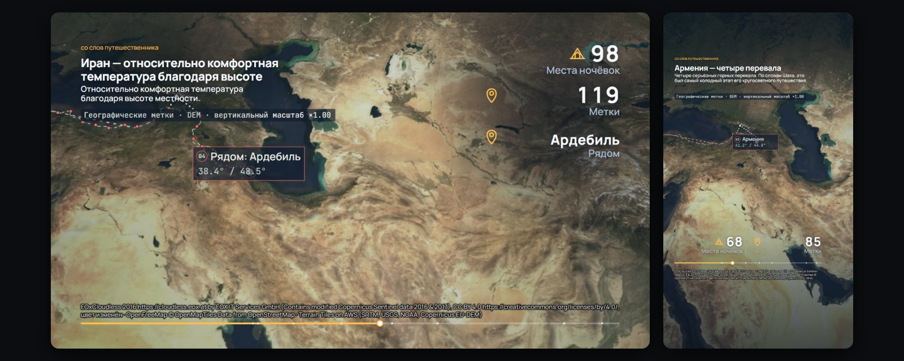
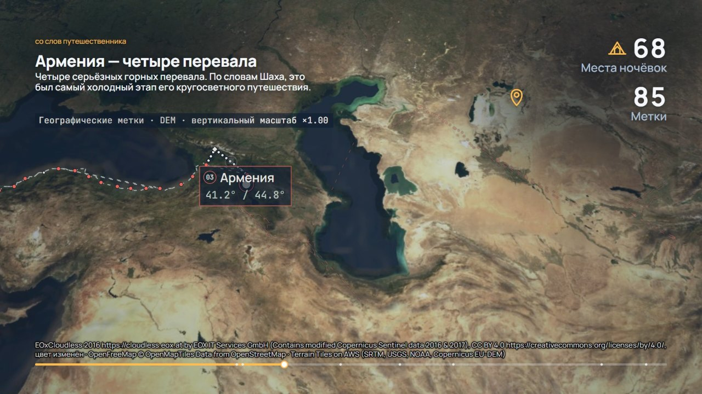
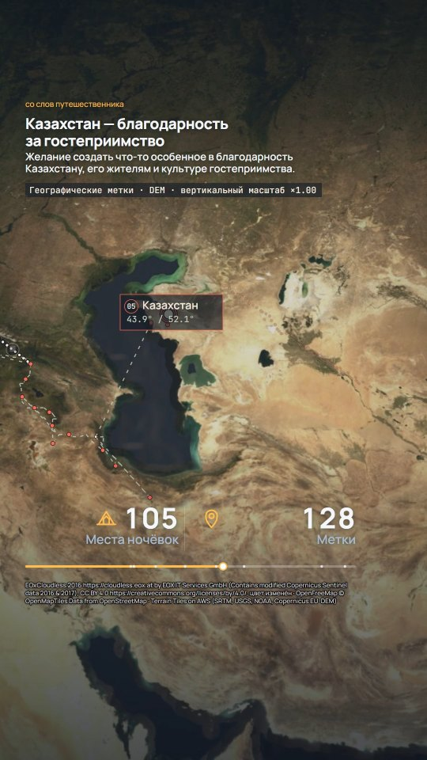
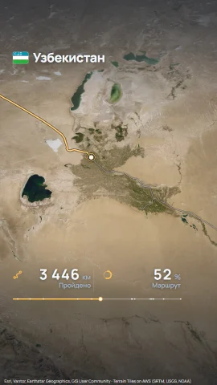
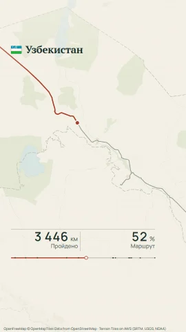
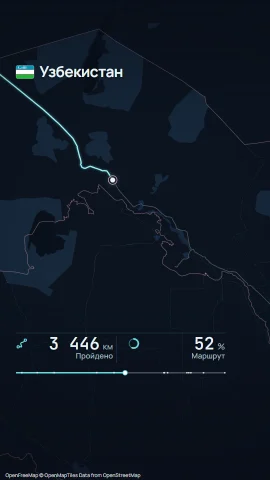

<div align="center">

# Route Story Engine

**GPS-трек или метки путешествия → анимированная видеоистория 9:16 / 16:9 прямо в браузере.**
<br>*Turn a GPS track or travel waypoints into a cinematic 9:16 / 16:9 video story — right in your browser.*

**ROUTE → STYLE → REPLAY → EXPORT**

[](https://romario499.github.io/route-story-engine/)
[](exports/submission/route-story-final-16x9.mp4)
[](exports/submission/route-story-final-9x16.mp4)

[](https://github.com/Romario499/route-story-engine/actions/workflows/deploy.yml)
[](LICENSE)




</div>

Загрузите маршрут — GPX, KML/KMZ (включая бэкап меток **Organic Maps**), GeoJSON или CSV — выберите стиль и получите готовый **H.264 MP4 1080p** для Reels, Shorts или YouTube. Всё считается и кодируется в браузере: без сервера, аккаунтов и ключей, файл маршрута не покидает компьютер.

## 🎬 Ролики конкурса «Вайбатон · Route Story»

Реальное путешествие **@wahrier** по его меткам Organic Maps: Турция → Грузия → Армения → Иран → Казахстан → Узбекистан → Таджикистан. 7 стран, 214 меток, 158 мест ночёвки, главы «со слов путешественника». Стиль «Экспедиция», 60 с.

<table>
<tr>
<td width="68%" align="center"><a href="exports/submission/route-story-final-16x9.mp4"></a><br><b>16:9 · 1920×1080 · 60 с</b> — <a href="exports/submission/route-story-final-16x9.mp4">MP4</a></td>
<td width="32%" align="center"><a href="exports/submission/route-story-final-9x16.mp4"></a><br><b>9:16 · 1080×1920 · 60 с</b> — <a href="exports/submission/route-story-final-9x16.mp4">MP4</a></td>
</tr>
</table>

Публикация роликов разрешена путешественником. Исходные файлы маршрута, координаты и тексты глав в репозиторий не входят. Материалы подачи: [текст](docs/submission/submission.md) · [сценарий защиты](docs/submission/demo-script.md) · [проверки](docs/submission/test-results.md) · [ограничения](docs/submission/limitations.md) · [источники](docs/submission/sources.md) · [титры](docs/submission/video-credits.md).

## ✨ Возможности

| | |
|---|---|
| 🗺️ **Любой маршрут** | GPX, KML/KMZ, GeoJSON, CSV; бэкап Organic Maps — метки, ночёвки, участки, выбор периода поездки. |
| 🎥 **Режиссура** | Камера шести сцен: обзор → подлёт → сопровождение → контекст → итог. Своё кадрирование для 9:16. |
| 🏔️ **Рельеф** | Спутник EOxCloudless и DEM-рельеф; вертикальный масштаб всегда подписан в кадре. |
| 📖 **История** | Флаги и плашки стран, выноски «рядом: город», главы «со слов путешественника» из JSON, итог поездки. |
| 🎨 **Три стиля** | «Экспедиция», «Атлас», «Неон». Форматы 9:16 и 16:9, длительность 15/30/45/60 с, RU/EN. |
| ⚡ **Экспорт в браузере** | WebCodecs, кадр за кадром, H.264 MP4 30 к/с (WebM — запасной вариант). Превью и экспорт рендерит одна сцена. |
| 🛡️ **Честные данные** | Разрывы трека не соединяются. Метки не выдаются за GPS-трек: без километража и скорости. Реконструкция помечена. |

<table>
<tr>
<td align="center"><br><b>Экспедиция</b><br>спутник · рельеф</td>
<td align="center"><br><b>Атлас</b><br>светлая карта · отмывка</td>
<td align="center"><br><b>Неон</b><br>тёмная карта</td>
</tr>
</table>

## 🚀 Демо за 2 минуты

1. Откройте [сайт](https://romario499.github.io/route-story-engine/) в десктопном **Chrome** или **Edge**.
2. Нажмите **«Пример: маршрут @wahrier»** или загрузите свой GPX/KML/KMZ/GeoJSON/CSV. Встроенный пример — помеченная реконструкция; конкурсные ролики сделаны отдельно, по реальным меткам путешественника. Для Organic Maps выберите участок и явно подтвердите порядок закладок, если он соответствует поездке.
3. Выберите стиль, формат 9:16 или 16:9, длительность и язык. Для короткого показа удобно 15 с.
4. Нажмите **Play**: камера, маршрут, главы и итог поездки.
5. Нажмите **«Экспортировать ролик»**, дождитесь завершения и **откройте скачанный MP4**.

Во время экспорта не сворачивайте вкладку. Время кодирования зависит от компьютера и сети.

## 🏆 Соответствие требованиям конкурса

| Требование / вес | Где и как выполнено |
|---|---|
| Готовый экспорт — 30% | Два MP4 выше: 9:16 (1080×1920) и 16:9 (1920×1080), по 60 с. H.264 кадр за кадром через WebCodecs; WebM — запасной вариант. |
| Визуал и storytelling — 25% | Три стиля, камера шести сцен, DEM с подписанным вертикальным масштабом, флаги, выноски «рядом: город», главы со слов путешественника, итог поездки. |
| Реальные данные, маршрут и анимация — 15% | Путешествие @wahrier по меткам Organic Maps. Метки, ночёвки и участки показаны без выдуманного километража; порядок закладок требует подтверждения. |
| UX — 10% | Загрузка → стиль → Play/replay → экспорт → открытие файла; встроенный пример для быстрого знакомства. |
| Техника — 10% | Vite + TypeScript strict, MapLibre, Canvas, WebCodecs; без бэкенда. 75 тестовых файлов / 842 passed, e2e Edge 28/28 — [результаты](docs/submission/test-results.md). |
| Reels/YouTube — 5% | Вертикальный и горизонтальный 1080p, 15/30/45/60 с, RU/EN. Загрузка на платформы отдельно не проверялась. |
| Демонстрация — 5% | [Сценарий защиты](docs/submission/demo-script.md) с обязательным открытием экспортированного видео. |
| Live URL, репозиторий + README | Ссылки в начале страницы; материалы подачи — в [docs/submission](docs/submission/). |

## 🛠️ Локальный запуск

Нужны Node.js ≥ 22.18 (проверено на 24.15), интернет для карт и Chrome/Edge для экспорта. В Windows PowerShell используйте `npm.cmd` / `npx.cmd`.

```bash
npm ci
npm run dev
```

Откройте адрес Vite, обычно http://localhost:5173. Аккаунты, ключи и переменные окружения приложению не нужны.

| Команда | Назначение |
|---|---|
| `npm run dev` | Сервер разработки. |
| `npm run build` / `npm run preview` | Проверка типов и сборка в `dist/` / просмотр сборки. |
| `npm test` / `npm run check` | Vitest / TypeScript + все юниты. |
| `npm run test:e2e` | Playwright в системном Edge; `RS_E2E_CHANNEL=chrome` переключает браузер. |
| `npm run exports` | Контрольная матрица в `exports/redesign/`; существующие MP4 не перезаписывает. `RS_EXPORT_ONLY` выбирает часть матрицы, `RS_EXPORT_REVIEW_EXISTING=1` перепроверяет готовые файлы. |
| `node scripts/make-style-thumbs.mjs` | Миниатюры стилей из рендера. |
| `npm run build:geodata` / `npm run build:sample` | Пересборка геоданных / встроенного примера с сетью; для запуска не требуется. |

## 📐 Форматы и достоверность

- **GPX:** треки, сегменты и маршруты; время и высота необязательны. **GeoJSON:** LineString/MultiLineString, Feature/FeatureCollection. **CSV:** поля lat/lon (также latitude/longitude, широта/долгота), необязательные ele/time; разделитель — запятая или точка с запятой.
- **KML/KMZ:** линии и метки, включая Organic Maps. Для смешанного импорта доступны представления трека и меток путешествия. Метки — не GPS-трек: километража и скорости нет, связи не доказывают пройденные дороги, время закладки не равно дате визита. Порядок закладок используется как порядок поездки только после явного подтверждения.
- **Разрывы GPS-трека** не соединяются линией. Километры записанных участков отделены от расстояния разрыва по прямой; способ перемещения в разрыве не предполагается.
- **Показатели** зависят от данных: километры, высота, день и страна для подходящих треков; метки и места ночёвки для Organic Maps. «Рядом: город» не доказывает посещение города.
- **Главы:** JSON по [схеме](public/samples/chapters.schema.json) загружается вместе с маршрутом; показываются совпавшие привязки, воспоминания помечаются «со слов путешественника». Редактора глав нет.
- **Встроенный пример @wahrier** — реконструкция по публичной афише и дорогам OSM, помеченная в кадре. Она не заменяет реальные метки, использованные в конкурсных видео.

## 🧱 Архитектура

```
файл ─► route (импорт, очистка) ─► geo (страны, города) ─► story (таймлайн, акты, камера)
     ─► render (MapLibre + Canvas 2D) ─► export (WebCodecs → MP4)
```

MapLibre рисует карту и рельеф, Canvas — маршрут, подписи и показатели. Превью и экспорт используют общую сцену и таймлайн; видео кодируется кадр за кадром в браузере. Подробнее — [архитектура](docs/architecture.md) и [решения (ADR)](docs/adr/).

## 📍 Ограничения

Экспорт рассчитан на десктопные Chrome/Edge; проверки выполнены в Edge. Карты требуют сети; EOX предоставляется «as-is», снимок с разрешением 10 м мягче на крупных планах. Вкладку при экспорте нужно держать активной. Нет звука, вставок фото/видео и редактора глав; маршруты через антимеридиан отклоняются. Проверка на телефонах и в приложениях соцсетей не выполнена. Подробнее — [ограничения](docs/submission/limitations.md).

## 📄 Лицензия и источники

**Код** — [MIT](LICENSE), © 2026 NRM.

**Не входят в MIT:**
- ролики и кадры путешествия @wahrier (`exports/`, `docs/submission/`, `docs/assets/`, `docs/visual-review/`), включая тексты глав. Они опубликованы с разрешения путешественника, права принадлежат авторам; повторное использование — только с их согласия;
- картографические и сторонние данные — под своими лицензиями: спутник **EOxCloudless 2016 — CC BY 4.0**, данные **© OpenStreetMap** (ODbL) через OpenFreeMap / OpenMapTiles, рельеф **Terrain Tiles on AWS**, **Natural Earth**, **flag-icons** (MIT), **MapLibre GL** (BSD-3-Clause), шрифты (OFL 1.1).

Атрибуция включена в каждый кадр. Полные условия — [источники](docs/submission/sources.md), текст для описания роликов — [титры](docs/submission/video-credits.md), лицензии пакетов — [THIRD-PARTY-NOTICES.txt](public/THIRD-PARTY-NOTICES.txt). Esri в проекте не используется ([ADR 0008](docs/adr/0008-usloviya-istochnikov-karty-dlya-video.md)).
